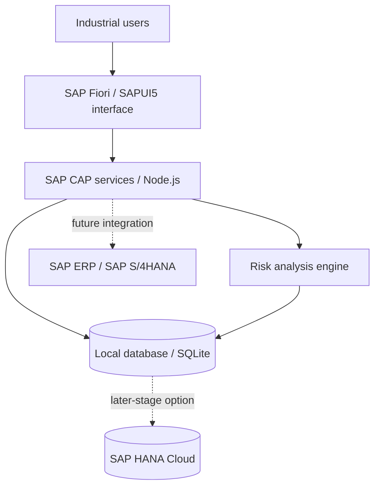

# 7. System architecture

## 7.1 Overview

MaintAI is planned as an independent application for its initial version. Its architecture separates the user interface, backend services, risk-analysis logic, and data persistence. Integration with SAP systems is a later stage and is not required for the local prototype.

## 7.2 Planned logical architecture



The diagram represents the intended logical organization, not a deployed architecture.

## 7.3 Components and responsibilities

### Frontend — SAP Fiori / SAPUI5

- Present the user interface.
- Display dashboards and indicators.
- Consult maintenance orders.
- Present material and stock information.
- Display alerts and recommendations.
- Allow users to evaluate and record decisions.

### Backend — SAP CAP / Node.js

- Expose services and APIs.
- Receive and validate requests.
- Apply business rules.
- Orchestrate application operations.
- Communicate with the database.
- Prepare the integration layer for future SAP connectivity.

### Risk analysis engine

- Identify scheduled orders.
- Retrieve required materials.
- Calculate availability.
- Identify shortages.
- Account for reservations and other storage locations.
- Consider replenishment lead times.
- Assess criticality and priority.
- Classify risks.
- Generate alerts and recommendations.

### Database

The initial data model is expected to cover equipment, materials, stock, storage locations, maintenance orders, order items, reservations and commitments considered by the application, suppliers, alerts, recommendations, and decision history.

### SAP integration

The integration layer is a future architectural concern. It depends on authorized access, available systems, enabled APIs, authentication and authorization definitions, and a data synchronization strategy.

## 7.4 Planned technologies

- JavaScript / Node.js.
- SAP Cloud Application Programming Model (CAP).
- Core Data Services (CDS).
- SQLite for the initial local database.
- SAP Fiori / SAPUI5 for the web interface.
- SAP HANA Cloud as a possible later-stage database.
- SQL, Git, GitHub, and Visual Studio Code.
- Python may be considered later if advanced analysis has a justified need.

## 7.5 Persistence strategy

The first version should use a local database to support development and repeatable tests. SQLite is the planned initial option. A later move to SAP HANA Cloud depends on project maturity, environment availability, and integration requirements.

## 7.6 Suggested initial application structure

```text
MaintAI/
├── app/
│   └── fiori/
│       └── webapp/
├── db/
│   ├── schema.cds
│   └── data/
├── srv/
│   ├── maintenance-service.cds
│   ├── maintenance-service.js
│   └── risk-engine.js
├── tests/
├── scripts/
│   └── seed-data.js
├── docs/
├── package.json
├── README.md
└── .gitignore
```

This is an initial proposal and may be adapted to SAP CAP conventions.

## 7.7 Environment preparation

The planned primary development environment is Visual Studio Code. Project setup should include the required Node.js and SAP CAP tooling, local database configuration, version control, and a repeatable way to load simulated data.

## 7.8 Open architectural decisions

- Final organization of CAP services.
- API contracts and endpoints.
- Authentication and authorization policy.
- Data update strategy.
- Deployment details.
- Final SAP HANA Cloud configuration.
- Concrete integration mechanism with SAP ERP / SAP S/4HANA.
