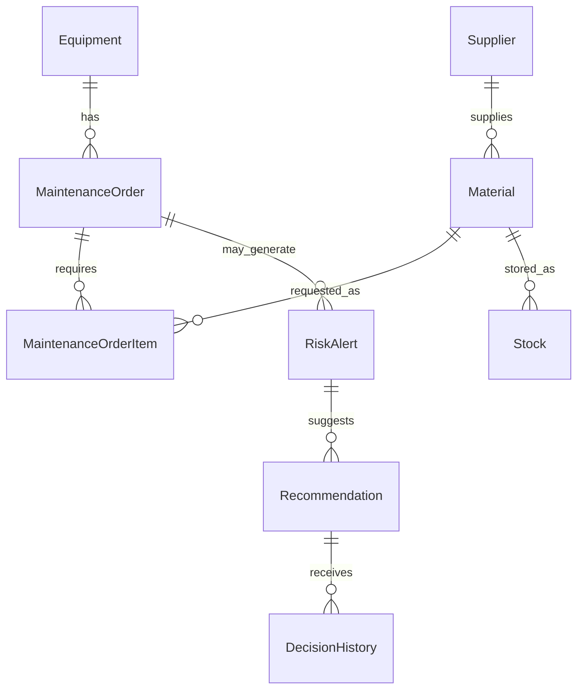

# 8. Data model

## 8.1 Purpose

This document describes the initial conceptual entities required to represent equipment, maintenance orders, materials, inventory, risk alerts, recommendations, and decisions. It is not a finalized physical database schema.

## 8.2 Entities

### Equipment
Represents an industrial asset. Expected information includes an equipment identifier, description, industrial area or location, category, criticality, and operational status.

### MaintenanceOrder
Represents a maintenance activity. Expected information includes an order identifier, related equipment, maintenance type, scheduled date, priority, and status.

### Material
Represents a part, component, or supply required for maintenance. Expected information includes a material identifier, description, category, and unit of measure. Supplier and replenishment information may also be associated.

### Stock
Represents inventory information for a material at a storage location. It should distinguish physical, reserved, committed, and available quantities as required by the business rules.

### MaintenanceOrderItem
Associates a maintenance order with a required material and quantity. One order may contain multiple material items.

### Supplier
Represents a supplier associated with materials and replenishment lead-time information.

### RiskAlert
Represents a risk situation identified by the analysis engine, including the related order, material shortage, risk level, and relevant dates or quantities.

### Recommendation
Represents an alternative suggested in response to an alert, such as checking another storage location, assessing a transfer, requesting replenishment, contacting a supplier, or reassessing the maintenance schedule.

### DecisionHistory
Records the evaluation of recommendations, including the decision, responsible person, date, and justification when provided.

## 8.3 Conceptual relationships

The diagram is conceptual. It does not define the final database keys, cardinality constraints, or physical schema.

## 8.4 Modeling considerations

- An order is associated with an equipment record.
- An order may contain multiple material items.
- A material may be used in multiple orders.
- A material may have stock records at different storage locations.
- An order may generate alerts related to shortages.
- An alert may originate recommendations.
- Decisions must remain available for later consultation in the history.

## 8.5 Items still to be defined

- Field types and lengths.
- Final primary and foreign keys.
- Uniqueness constraints.
- Formal storage-location entity and its attributes.
- Detailed modeling of reservations and commitments.
- Stock-change history.
- Data update and synchronization policy.
- Allowed states for alerts and recommendations.

## 8.6 Essential integrity rule

The same stock quantity must not be deducted more than once. The model and calculation logic must make clear whether reservations and commitments have already been reflected in the stock balance used by the analysis.
