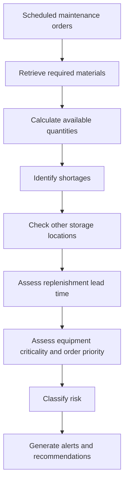

# 9. Risk analysis engine

## 9.1 Purpose

The risk analysis engine is intended to evaluate whether materials required by scheduled maintenance orders are likely to be available by the planned execution date. It should identify shortages, consider possible alternatives, classify the situation, and provide the information needed for alerts and recommendations.

## 9.2 Analysis inputs

- Scheduled maintenance orders.
- Related equipment.
- Equipment criticality.
- Order priority and scheduled date.
- Required materials.
- Required quantities.
- Physical stock.
- Reserved quantities.
- Committed quantities not yet deducted.
- Availability at other storage locations.
- Estimated replenishment lead times.

## 9.3 Processing flow



## 9.4 Processing steps

1. Identify scheduled orders.
2. Retrieve the materials required by each order.
3. Check available quantities.
4. Deduct reservations and commitments that have not yet been considered.
5. Identify shortages.
6. Check potential alternatives at other storage locations.
7. Consider replenishment lead times.
8. Assess equipment criticality and order priority.
9. Calculate or classify the risk level using defined rules.
10. Generate alerts and recommendations.

## 9.5 Initial calculations

The initial availability concept is:

```text
Available quantity = physical quantity - reserved quantity - committed quantity not yet deducted
Shortage = required quantity - available quantity for the order
```

The implementation must avoid duplicate deductions. The precise treatment of each commitment type remains a design decision to be validated during implementation.

## 9.6 Time-based assessment

When the required dates are available, the engine should compare the scheduled maintenance date with the estimated replenishment date. A replenishment expected after the maintenance date may increase the risk and should be visible in the alert. The system should not invent a delivery date when supplier information is unavailable.

## 9.7 Risk classification

The classification should consider:
- Material shortage.
- Scheduled maintenance date.
- Replenishment lead time.
- Availability at other storage locations.
- Equipment criticality.
- Order priority.
- Existence of alternatives.

The initial classification should be deterministic, transparent, and testable. Exact risk levels, thresholds, and weighting rules remain to be defined.

## 9.8 Engine outputs

Where the information is available, the output should include:
- Equipment.
- Maintenance order.
- Scheduled date.
- Short material.
- Required quantity.
- Available quantity.
- Missing quantity.
- Estimated replenishment lead time or date.
- Equipment criticality.
- Risk level.
- Recommendations.

## 9.9 Possible recommendations

- Check availability at other storage locations.
- Assess a material transfer.
- Request or expedite a purchase.
- Contact the supplier.
- Reassess the maintenance schedule.

These are alternatives for human assessment, not automatic actions.

## 9.10 Explainability and traceability

The system should make it possible to understand why a risk was classified and which data contributed to the result. Alerts should retain the relevant quantities, dates, criticality, priority, and alternatives used by the analysis. Decisions about recommendations should be recorded in the history.

## 9.11 Limitations

The initial engine is not an AI or machine-learning system and does not predict physical equipment failures. Its purpose is to identify risks related to material availability and scheduled maintenance execution. Its results depend on the quality, completeness, and timeliness of the available data.
