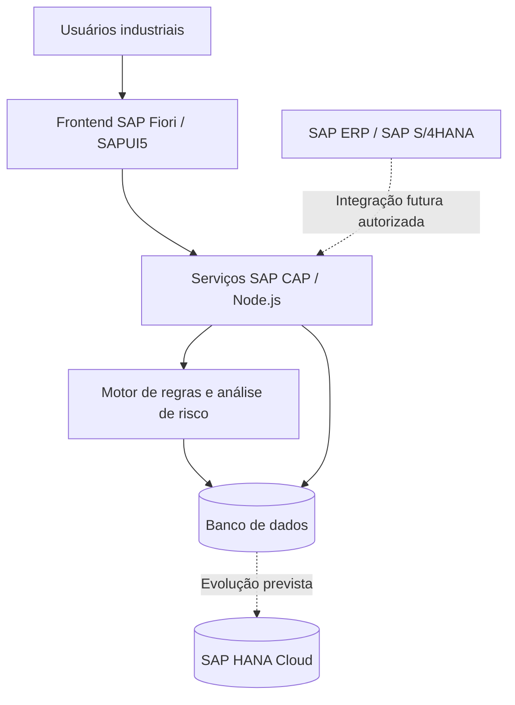

# 7. Arquitetura do sistema

## 7.1 Visão geral

O MaintAI deverá ser organizado em componentes responsáveis pela interface, serviços de aplicação, análise de risco, persistência de dados e futura integração SAP.

A primeira versão será executada localmente e utilizará dados simulados. A arquitetura deverá permitir evolução sem exigir que a integração corporativa esteja disponível desde o início.

## 7.2 Arquitetura lógica prevista



O diagrama representa a arquitetura lógica pretendida, não uma implantação já concluída.

## 7.3 Componentes e responsabilidades

### Frontend — SAP Fiori / SAPUI5

Responsabilidades previstas:

- Apresentar a interface.
- Exibir dashboard e indicadores.
- Consultar ordens de manutenção.
- Apresentar informações de materiais e estoques.
- Exibir alertas e recomendações.
- Permitir avaliação e registro de decisões.

### Backend — SAP CAP / Node.js

Responsabilidades previstas:

- Disponibilizar serviços e APIs.
- Receber e validar solicitações.
- Aplicar regras de negócio.
- Orquestrar operações da aplicação.
- Comunicar-se com o banco de dados.
- Preparar a camada de integração com sistemas SAP.

### Motor de análise de risco

Responsabilidades previstas:

- Identificar ordens programadas.
- Consultar materiais necessários.
- Calcular disponibilidade.
- Identificar déficits.
- Considerar reservas e outros depósitos.
- Considerar prazos de reposição.
- Avaliar criticidade e prioridade.
- Classificar riscos.
- Gerar alertas e recomendações.

A primeira versão deverá utilizar regras determinísticas e explicáveis.

### Banco de dados

Deverá armazenar, entre outros dados:

- Equipamentos.
- Materiais.
- Estoques.
- Depósitos.
- Ordens de manutenção.
- Itens das ordens.
- Reservas e compromissos considerados pela aplicação.
- Fornecedores.
- Alertas.
- Recomendações.
- Histórico de decisões.

### Integração SAP

Em etapa posterior, poderá realizar leitura e sincronização autorizada de informações provenientes de SAP ERP / SAP S/4HANA, conforme APIs e ambientes disponíveis.

## 7.4 Tecnologias previstas

| Tecnologia | Utilização planejada |
|---|---|
| Visual Studio Code | Ambiente de desenvolvimento |
| JavaScript | Linguagem do backend |
| Node.js | Ambiente de execução |
| SAP CAP | Framework de serviços e APIs |
| CDS | Modelagem de dados e serviços |
| SQL | Consultas e manipulação de dados |
| SQLite | Banco inicial local para desenvolvimento e testes |
| SAP HANA Cloud | Banco previsto para etapa posterior |
| SAP Fiori / SAPUI5 | Interface web |
| Git / GitHub | Versionamento e publicação |
| Python | Opcional para análises avançadas futuras |

## 7.5 Estratégia de persistência

O desenvolvimento deverá começar com SQLite. Não é necessário configurar SAP HANA Cloud logo no início.

Primeiro será construído e validado o sistema com dados simulados. Depois, a aplicação poderá ser preparada para utilizar SAP HANA Cloud, considerando as adaptações necessárias.

## 7.6 Estrutura inicial sugerida para a aplicação

A estrutura do repositório de código proposta no documento de projeto é:

```text
MaintAI/
├── app/
│   └── fiori/
│       └── webapp/
├── db/
│   ├── schema.cds
│   └── data/
├── srv/
│   ├── maintenance-service.cds
│   ├── maintenance-service.js
│   └── risk-engine.js
├── tests/
├── scripts/
│   └── seed-data.js
├── docs/
├── package.json
├── README.md
└── .gitignore
```

Essa estrutura é uma proposta inicial e poderá ser adaptada às convenções do SAP CAP.

## 7.7 Preparação do ambiente

Comandos previstos no planejamento inicial:

```bash
npm install -g @sap/cds-dk

node -v
npm -v
git --version
cds -v

cds init maintai --nodejs
cd maintai
cds watch
```

A execução desses comandos depende das ferramentas e versões compatíveis instaladas no ambiente.

## 7.8 Decisões ainda em aberto

- Organização final dos serviços CAP.
- Contratos e endpoints das APIs.
- Política de autenticação e autorização.
- Estratégia de atualização dos dados.
- Detalhes de implantação.
- Configuração definitiva de SAP HANA Cloud.
- Mecanismo concreto de integração com SAP ERP / SAP S/4HANA.

Essas decisões deverão ser registradas à medida que forem definidas.
