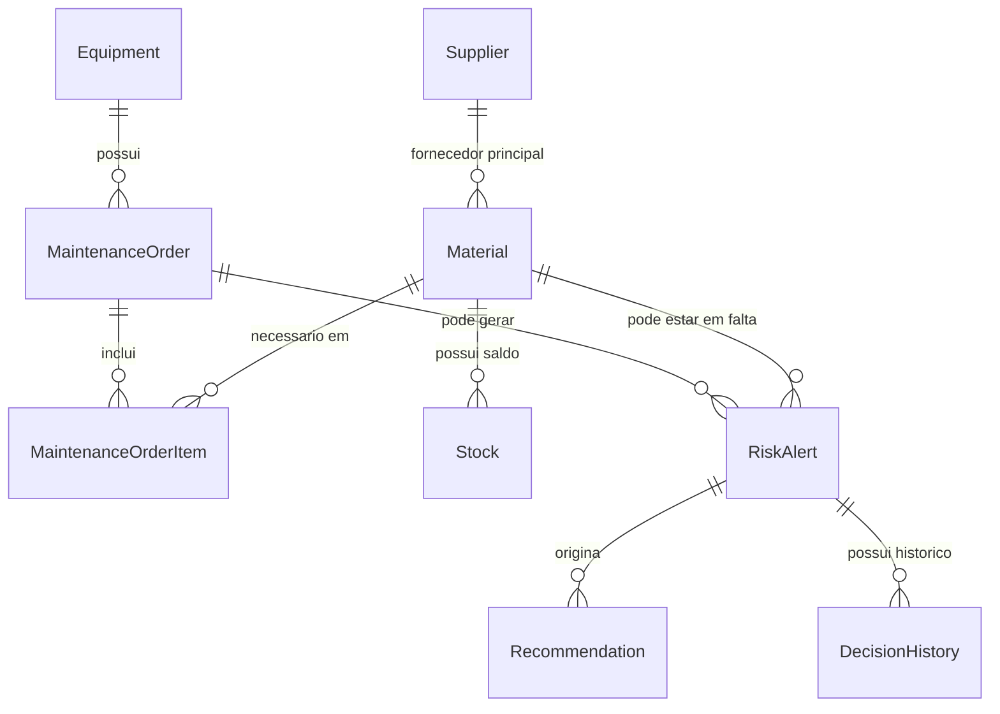

# 8. Modelo de dados

## 8.1 Objetivo

Este documento descreve as principais entidades previstas para o MaintAI. O modelo é inicial e poderá ser ajustado durante o levantamento de requisitos e a implementação.

Os campos listados são possibilidades previstas no planejamento, não um schema físico já implementado.

## 8.2 Entidades

### Equipment

Representa os equipamentos industriais.

| Campo previsto | Descrição |
|---|---|
| ID | Identificador do registro |
| Código | Código do equipamento |
| Nome | Nome do equipamento |
| Descrição | Descrição complementar |
| Localização | Localização do equipamento |
| Setor | Setor industrial |
| Criticidade | Criticidade do equipamento |
| Status | Situação operacional |

### MaintenanceOrder

Representa as ordens de manutenção.

| Campo previsto | Descrição |
|---|---|
| ID | Identificador do registro |
| Número da ordem | Identificação da ordem |
| Equipment ID | Equipamento relacionado |
| Tipo de manutenção | Tipo da manutenção |
| Data programada | Data prevista para execução |
| Prioridade | Prioridade da ordem |
| Status | Situação da ordem |

### Material

Representa peças e materiais.

| Campo previsto | Descrição |
|---|---|
| ID | Identificador do registro |
| Código | Código do material |
| Descrição | Descrição do material |
| Unidade de medida | Unidade utilizada |
| Estoque mínimo | Estoque mínimo, quando aplicável |
| Fornecedor principal | Fornecedor associado |

### Stock

Representa a disponibilidade de materiais por depósito.

| Campo previsto | Descrição |
|---|---|
| ID | Identificador do registro |
| Material ID | Material relacionado |
| Depósito | Depósito onde o material está armazenado |
| Quantidade física | Quantidade física registrada |
| Quantidade reservada | Quantidade reservada |
| Quantidade disponível | Quantidade disponível conforme regra adotada |

### MaintenanceOrderItem

Relaciona materiais às ordens de manutenção.

| Campo previsto | Descrição |
|---|---|
| ID | Identificador do registro |
| Maintenance Order ID | Ordem relacionada |
| Material ID | Material necessário |
| Quantidade necessária | Quantidade exigida pela ordem |

### Supplier

Representa fornecedores.

| Campo previsto | Descrição |
|---|---|
| ID | Identificador do registro |
| Nome | Nome do fornecedor |
| Identificação | Identificação do fornecedor |
| Prazo de reposição | Prazo estimado de reposição |
| Status | Situação do fornecedor |

### RiskAlert

Representa os alertas gerados pelo sistema.

| Campo previsto | Descrição |
|---|---|
| ID | Identificador do registro |
| Ordem relacionada | Ordem associada ao alerta |
| Material relacionado | Material associado ao alerta |
| Quantidade faltante | Déficit identificado |
| Nível de risco | Classificação atribuída |
| Data de identificação | Data em que o alerta foi identificado |
| Descrição | Detalhes da situação |
| Status | Situação do alerta |

### Recommendation

Representa as recomendações apresentadas pelo sistema.

| Campo previsto | Descrição |
|---|---|
| ID | Identificador do registro |
| Alerta relacionado | Alerta que originou a recomendação |
| Tipo de recomendação | Categoria da alternativa sugerida |
| Descrição | Explicação da recomendação |
| Status de aprovação | Situação da avaliação |
| Responsável | Responsável pela decisão |
| Data de decisão | Data da decisão |

### DecisionHistory

Representa o histórico de decisões.

| Campo previsto | Descrição |
|---|---|
| ID | Identificador do registro |
| Alerta relacionado | Alerta associado |
| Usuário responsável | Usuário que tomou a decisão |
| Decisão | Decisão registrada |
| Justificativa | Motivo informado |
| Data | Data do registro |

## 8.3 Relacionamentos conceituais

O diagrama é conceitual. Cardinalidades e entidades auxiliares poderão ser refinadas. A entidade de depósito aparece como atributo conceitual de `Stock` no modelo inicial e poderá ser normalizada em uma entidade própria durante a implementação.

## 8.4 Considerações de modelagem

- Uma ordem está relacionada a um equipamento.
- Uma ordem pode possuir vários itens de materiais.
- Um material pode ser utilizado em várias ordens.
- Um material pode possuir registros de estoque em diferentes depósitos.
- Uma ordem pode gerar alertas relacionados a insuficiências.
- Um alerta pode originar recomendações.
- Decisões devem permanecer consultáveis no histórico.

## 8.5 Pontos a definir

- Tipos e tamanhos dos campos.
- Chaves primárias e estrangeiras definitivas.
- Restrições de unicidade.
- Entidade formal para depósitos.
- Modelagem detalhada de reservas e compromissos.
- Histórico de alterações de estoque.
- Política de atualização e sincronização de dados.
- Estados permitidos para alertas e recomendações.

## 8.6 Regra de integridade essencial

A modelagem e os serviços deverão permitir identificar a origem dos saldos e compromissos utilizados no cálculo de disponibilidade. Isso é necessário para evitar que reservas ou compromissos sejam descontados mais de uma vez.
