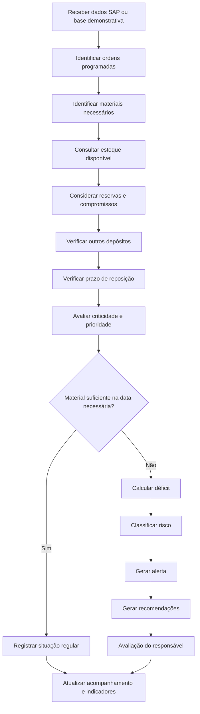

# 9. Motor de análise de risco

## 9.1 Objetivo

O motor de análise de risco é um dos principais componentes do MaintAI. Sua responsabilidade é identificar situações em que uma manutenção programada possa ser prejudicada pela falta de materiais necessários à sua execução.

A primeira versão deverá utilizar regras determinísticas e explicáveis, sem depender de inteligência artificial complexa ou aprendizado de máquina.

## 9.2 Entradas da análise

Conforme disponibilidade dos dados, o motor deverá utilizar:

- Ordens de manutenção programadas.
- Equipamentos relacionados.
- Criticidade dos equipamentos.
- Prioridade e data das ordens.
- Materiais necessários.
- Quantidades necessárias.
- Estoque físico.
- Quantidades reservadas.
- Quantidades comprometidas ainda não descontadas.
- Disponibilidade em outros depósitos.
- Prazos estimados de reposição.

## 9.3 Fluxo de processamento



## 9.4 Etapas

1. Identificar ordens programadas.
2. Consultar os materiais necessários para cada ordem.
3. Verificar quantidades disponíveis.
4. Descontar reservas e compromissos que ainda não tenham sido considerados.
5. Identificar déficits.
6. Verificar possíveis alternativas em outros depósitos.
7. Considerar prazos de reposição.
8. Avaliar criticidade do equipamento e prioridade da ordem.
9. Calcular ou classificar o nível de risco.
10. Gerar alertas e recomendações.

## 9.5 Cálculos iniciais

Disponibilidade:

```text
Quantidade disponível =
    Quantidade física
    - Quantidade reservada
    - Quantidade comprometida ainda não descontada
```

Déficit:

```text
Déficit = Quantidade necessária - Quantidade disponível para a ordem
```

Se o déficit for maior que zero, existe insuficiência de materiais.

A implementação deverá garantir que reservas e compromissos não sejam descontados em duplicidade.

## 9.6 Avaliação temporal

O motor deverá relacionar a data programada da manutenção ao prazo estimado de reposição. Também deverá verificar a possibilidade de encontrar materiais em outros depósitos.

A documentação inicial define esses fatores como entradas da análise, mas não estabelece uma fórmula fechada de pontuação ou uma matriz de risco. Os critérios exatos deverão ser definidos, testados e documentados antes de serem tratados como regra oficial.

## 9.7 Classificação de risco

A classificação deverá considerar, no mínimo, os fatores previstos:

- Déficit de materiais.
- Data da manutenção.
- Prazo de reposição.
- Disponibilidade em outros depósitos.
- Criticidade do equipamento.
- Prioridade da ordem.
- Existência de alternativas.

A classificação deverá ser transparente, reproduzível e explicável. Os níveis, pesos e limites ainda são decisões em aberto.

## 9.8 Saídas do motor

Quando identificar uma situação de risco, o motor deverá produzir informações para um alerta contendo:

- Equipamento.
- Ordem de manutenção.
- Data programada.
- Material em falta.
- Quantidade necessária.
- Quantidade disponível.
- Quantidade faltante.
- Prazo estimado de reposição, quando disponível.
- Criticidade do equipamento.
- Nível de risco.
- Recomendações.

O motor também deverá permitir registrar situações regulares para acompanhamento e atualização do dashboard.

## 9.9 Recomendações possíveis

- Verificar disponibilidade em outros depósitos.
- Avaliar transferência de materiais.
- Solicitar ou antecipar uma compra.
- Consultar o fornecedor.
- Reavaliar o planejamento da manutenção.

As recomendações são sugestões para avaliação. Não deverão executar automaticamente compras, transferências ou alterações em ordens.

## 9.10 Explicabilidade e rastreabilidade

Sempre que possível, o alerta deverá permitir compreender quais informações contribuíram para a identificação do risco: material, quantidade necessária, saldo considerado, déficit, prazo, data da manutenção e criticidade.

A decisão tomada pelo responsável deverá ser registrada para acompanhamento posterior.

## 9.11 Limites

O motor analisa riscos de indisponibilidade de materiais e possíveis impactos na execução de manutenções programadas. Ele não prevê falhas físicas de equipamentos e não deve apresentar seus resultados como previsões desse tipo.
